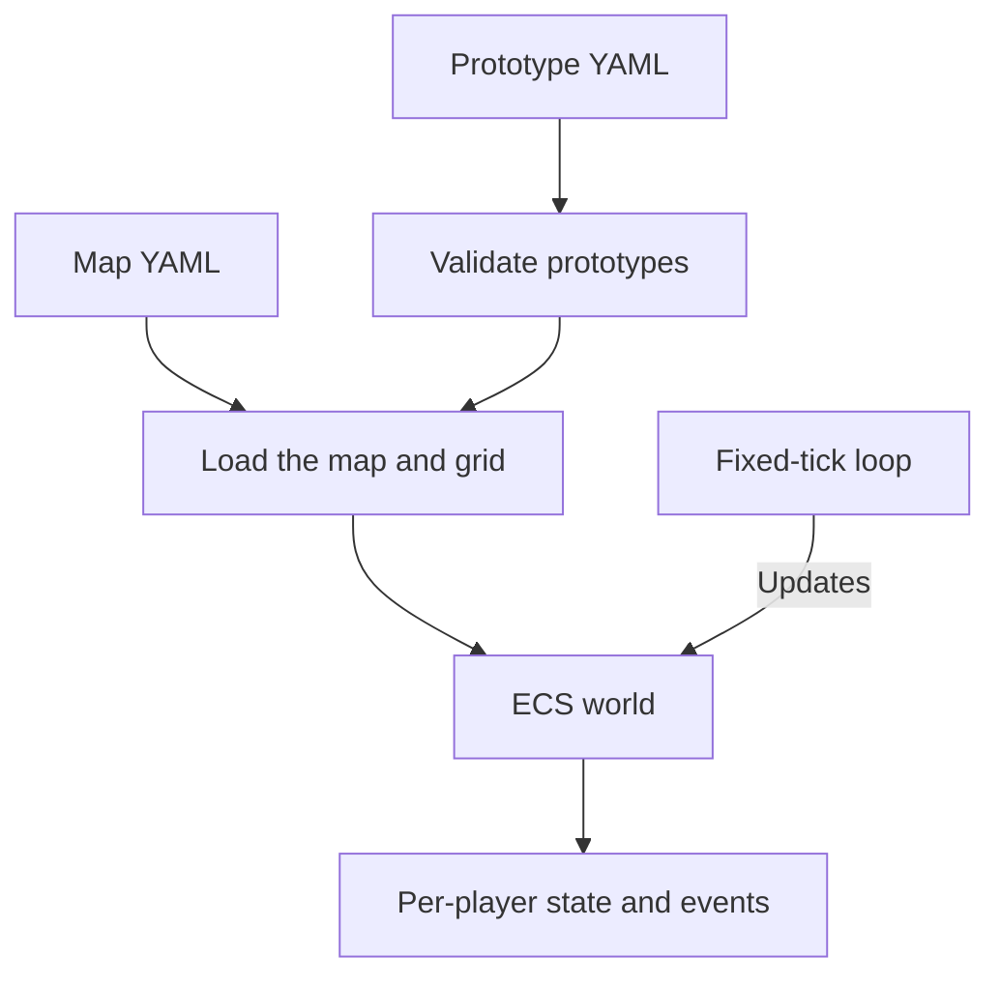
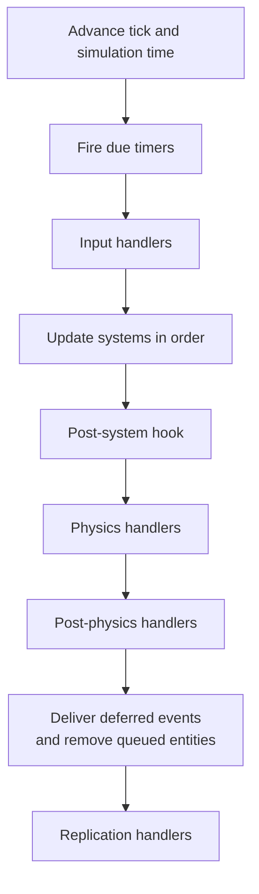

# Architecture

## World and data

The map loader turns validated definitions and map data into entities and components. The fixed-tick loop advances that world, and replication prepares state and events for each player.

`crucible-ecs` stores entities and components and builds a world from registered components and systems. The `networked` attribute from `crucible-ecs-macros` generates per-field replication masks and setters. `crucible-proto` parses and validates typed prototypes, including component definitions and inheritance. `crucible-loc` resolves localization entries.

`crucible-map` loads tile definitions and map entities, tracks grids and transforms, and provides spatial queries. The [map-loading example](examples/load-a-map.md) shows the path from YAML fixtures to the world.

## Simulation ticks

[`GameLoop::tick_with`](../../backend/crates/crucible-loop/src/game_loop.rs) runs these steps in order. Replication follows deferred events and queued removal, so its handlers can observe the world at the end of the tick.

`crucible-physics` advances 2D bodies and exposes collision state. Its ECS integration exchanges components with the physics world. `crucible-effects` registers and executes data-driven effects and conditions.

See [the phase-by-phase walkthrough](simulation-loop.md) for the inputs and outputs of each step and [simulation metrics](metrics.md) for its measurement boundaries.

## Integration and testing

`crucible-ext` registers engine modules and assembles their configuration. `crucible-players` manages sessions and player profiles. `crucible-replication` produces per-player state and visibility data for the transport layer. `crucible-testkit` provides fixtures and virtual clients for headless scenarios.

See [the versioning policy](../../VERSIONING.md) for the scope of the compatibility contract.
