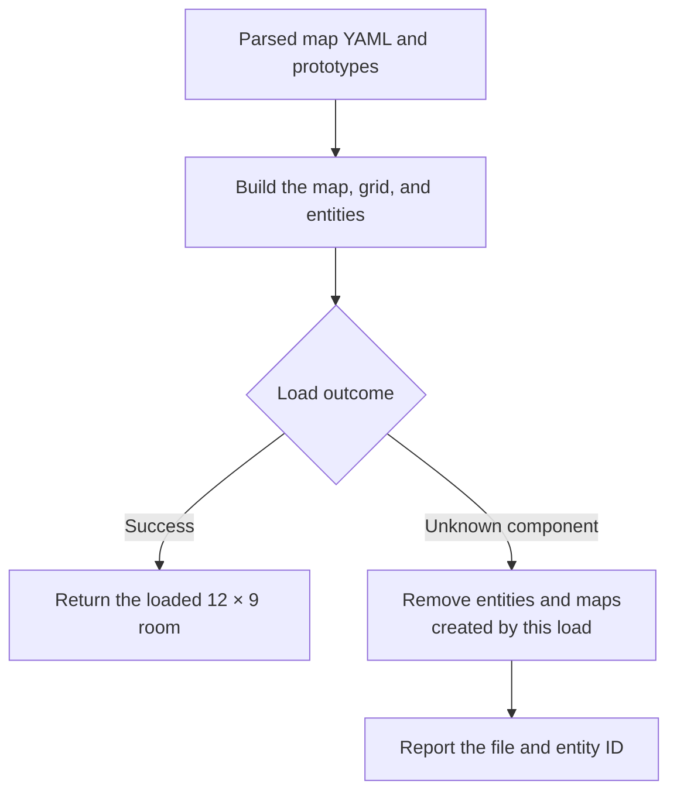

# Load a tile map

Follow [`loading_the_test_map`](../../../backend/crates/crucible-map/tests/map_loading.rs) to see prototype loading, entity creation, and tile queries in one scenario.

```sh
cd backend
cargo test --locked -p crucible-map --test map_loading
```

## From fixture to world

The test registers prototype and component schemas, then loads the [tile definitions](../../../backend/crates/crucible-map/tests/fixtures/tiles.yml) and in-memory entity prototypes. It creates an ECS world and passes a fixture component spawner to `MapLoader::load_file`, which reads the [room fixture](../../../backend/crates/crucible-map/tests/fixtures/room.yml).



The successful load creates one map, one grid, and 50 room entities. The assertions check the 12 × 9 layout, perimeter plating, transform coordinates, and a file-supplied lamp color that overrides a prototype default.

In the rollback test, entity 2 has an unregistered component. The error names the source file and the entity ID, and the world keeps its original entity count with no map left behind.
